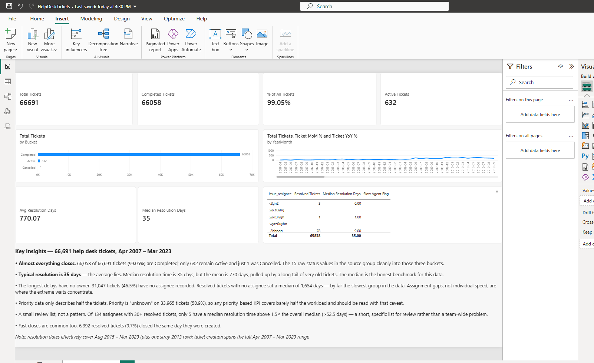

# Help Desk Ticket Analysis — Power BI (Star Schema + Validation Log)

A Power BI report built on 66,691 real help desk tickets, modeled as a
six-dimension star schema — with a source-to-target validation log tying
every headline figure back to the source data.

Dataset: Help Desk Tickets v3, Mendeley Data (DOI 10.17632/btm76zndnt.3),
PostgreSQL-extracted ticket data, Jan 2007 – Mar 2023
(actual range in source: 2007-04-15 to 2023-03-14).

## Business questions the report answers
1. How much work comes in, trending how?
2. What's the state of the work — backlog or done?
3. What kind of work is it?
4. What's urgent?
5. Which project generates the work?
6. Who does the work, and who requests it?
7. How fast is work finished?
8. Which agents are consistently slow to resolve? *(added during analysis —
   the question the data itself argued for)*

## Headline numbers (all tied out, source vs DAX)
- Total Tickets: **66,691**
- Completed: **66,058** · Active: **632** · Cancelled: **1**
  (66,058 + 632 + 1 = 66,691 — bucket tie-out passes)
- Completion share: **99.05%**
- 15 raw status values in source, grouped into the three buckets above
  (Completed = closed/done; Cancelled = cancelled; Active = the other 12)

## Key findings
- **Typical resolution is 35 days — the average lies.** Median resolution
  time is 35 days; the mean is 770 days, pulled up by a long tail of very
  old tickets. The median is the honest benchmark for this data.
- **The longest delays have no owner.** 31,047 tickets (46.5%) have no
  assignee recorded. Resolved tickets with no assignee sat a median of
  1,654 days — by far the slowest group. Assignment gaps, not individual
  speed, are where the extreme waits concentrate.
- **Priority data only describes half the tickets.** Priority is "unknown"
  on 33,965 tickets (50.9%), so any priority-based KPI covers barely half
  the workload.
- **A small review list, not a pattern.** Of 134 assignees with 30+
  resolved tickets, only 5 have a median resolution time above 1.5× the
  overall median (>52.5 days).
- **Fast closes are common too.** 6,392 resolved tickets (9.7%) closed the
  same day they were created.
- Resolution dates effectively cover Aug 2015 – Mar 2023 (plus one stray
  2013 row); ticket creation spans the full Apr 2007 – Mar 2023 range.

## Model
- Fact: `issues` (66,691 rows)
- Dimensions: DimStatus, DimType, DimPriority, DimProject, DimAssignee,
  DimDate — all 1-to-many into the fact
- DimPriority sorts by PriorityRank; DimDate is marked as the date table
- Technical keys and fact-side dimension copies are hidden in report view,
  so the dimensions are the only slicing doors in

## Measures & DAX techniques (all built and verified in the model)
- Base counts: Total / Completed / Active Tickets (COUNTROWS + CALCULATE)
- **Open Tickets** — CALCULATE filter on the fact table's own status
  column (97 tickets); built to demonstrate filter override vs. stacking:
  a same-column slicer is overridden by CALCULATE, a different-column
  slicer stacks and returns blank
- **% of All Tickets** — DIVIDE over CALCULATE with ALL, shares verified
  per bucket (99.05% / 0.95% / 0.00%)
- Time intelligence: **Tickets YTD** (TOTALYTD), **Tickets PY**
  (SAMEPERIODLASTYEAR), **Ticket YoY %**, **Ticket MoM %** (VAR/RETURN
  with DATEADD) — MoM verified row-by-row against source monthly counts
- **Status Bucket** — SWITCH over the 15 validated raw statuses
- **Resolution Days** — calculated column (DATEDIFF, blanks preserved so
  unfinished tickets never vote in the summaries)
- **Median / Average Resolution Days** — 35 / 770 days on 65,838 resolved
  tickets (**Resolved Tickets** counts tickets carrying a resolution date,
  not a completed status — the two differ by 220 rows in this data)
- **Slow Agent Flag** — VAR + REMOVEFILTERS: flags an assignee whose
  median exceeds 1.5× the overall median with a ≥30-resolved-ticket
  volume floor; the "Unassigned" group is excluded at the visual level
  because it is a data-quality bucket, not a person

## Data-quality findings (the part most portfolios skip)
Full detail in `validation-log.md` — highlights:
- **0** duplicate ticket IDs, **0** nulls on key columns
- Assignee blank on 31,047 tickets (46.5%) — kept as an explicit
  "Unassigned" dimension member rather than dropping rows
- Priority = "unknown" on 33,965 tickets (50.9%) — kept as its own
  category; half the data is never silently dropped
- `issue_type` contains both "Subtask" (4,746) and "Sub-task" (544) —
  the same label with a hyphenation variant; merged at the dimension
  level, source values untouched
- Tooling trap caught during the build: Power Query profiles sample the
  top 1,000 rows by default and initially showed only 2 of the 15
  statuses — "Load more" confirmed all 15 before any bucketing was built
- **Year-by-year tie-out (validation check #8):** grand total exact at
  66,691. A few years differ from the source-side key by ±1 (2023 by −8);
  every delta is a ticket created within hours of a January 1 boundary —
  the model groups timestamps in Central time, the key grouped them in
  UTC. No rows are missing or duplicated; the variance is documented in
  the validation log rather than adjusted away

## Validation
All 8 source-to-target checks in `validation-log.md` pass, including the
year-by-year tie-out above. The log is written in test-case format
(expected / actual / result / fix-or-decision) and is part of this repo.

## Files in this repo
- `README.md` — this file
- `validation-log.md` — the full source-to-target QA log
- `report-page.png` — screenshot of the report page
- `HelpDeskTicketAnalysis.pdf` — PDF export of the report
- The `.pbix` is a local Power BI Desktop file (no Power BI Service
  tenant was used for this project)
